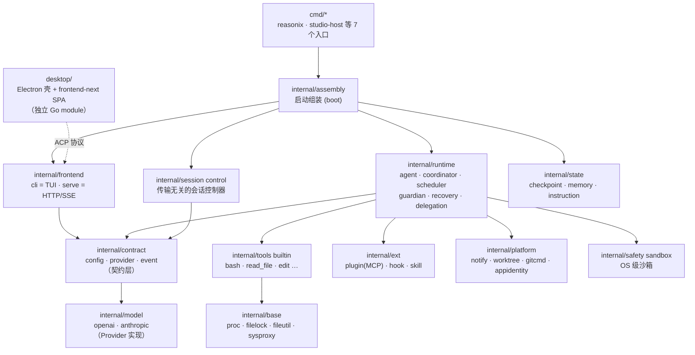

# 维护者 Wiki（Maintainer Wiki）

> 本文档面向 **SDSGK/DeepSeek-Reasonix** 的维护者：一张图看懂项目结构、模块依赖、
> 自动化测试与配置模块的位置。上游 esengine/DeepSeek-Reasonix 已于 2026-11-12
> 停止维护，本仓库自其 `studio` 分支（2.x 线）独立维护。
>
> 修改代码结构或配置体系后，请同步更新本文件。

---

## 1. 顶层目录一览

```text
DeepSeek-Reasonix/
├── cmd/                     # Go 程序入口（7 个）
│   ├── reasonix/            #   CLI 主入口（TUI + 子命令 + setup 向导）
│   ├── reasonix-studio-host/#   Studio 桌面宿主
│   ├── studio-delta/        #   Studio 增量更新
│   ├── signpath-contract/   #   签名契约校验（上游遗留，可删）
│   ├── extension-protocol-gen/ # 扩展协议文档生成器
│   ├── e2ebench/            #   e2e 基准
│   └── reasonix-plugin-example/ # 插件示例
├── internal/                # 内核（12 个一级包，依赖关系见 §2）
│   ├── assembly/            #   启动组装（boot）
│   ├── base/                #   基础设施：proc / filelock / fileutil / sysproxy
│   ├── contract/            #   契约层：config / provider / event（接口定义）
│   ├── ext/                 #   扩展机制：plugin(MCP) / hook / skill
│   ├── frontend/            #   前端：cli(TUI) / serve(HTTP/SSE)
│   ├── model/               #   Provider 实现：openai / anthropic
│   ├── platform/            #   平台服务：notify / worktree / gitcmd / appidentity
│   ├── runtime/             #   运行时：agent / coordinator / scheduler 等 21 个子包
│   ├── safety/              #   安全：sandbox（OS 级沙箱）
│   ├── session/             #   会话：control（传输无关的控制器）
│   ├── state/               #   状态：checkpoint(回退) / memory / instruction
│   └── tools/               #   内置工具：bash / read_file / edit …
├── desktop/                 # Reasonix Studio 桌面端（独立 Go module）
│   ├── electron/            #   Electron 壳 + electron-builder 打包配置
│   ├── frontend-next/       #   Studio 前端 SPA（Node 24 + pnpm 10）
│   ├── cmd/                 #   sign / studio-manifest / update-helper
│   ├── internal/winuninstall/
│   └── packaging/           #   打包资产
├── docs/                    # 工程文档（本 wiki、指南、合约、安全评审）
├── scripts/                 # 维护脚本（CI 辅助、致谢更新等）
├── sdk/go/                  # Go SDK（嵌套 module，CI 单独测）
├── npm/                     # npm 包包装器 + 发布脚本（上游渠道）
├── integrations/dsh-plugin/ # DSH 插件市场索引（market-index.json）
├── workers/                 # 上游 Cloudflare Workers（accounts/crash/forum，可删）
├── tools/ · benchmarks/ · examples/ · output/ · release-notes/
├── .github/workflows/       # CI（保留 7 个，见 §3）
├── .reasonix/               # 项目级 Reasonix 配置（commands）
├── .signpath/               # 上游签名契约（可删）
└── .githooks/               # git hooks（pre-push 跑 go vet）
```

## 2. 模块依赖关系图

依赖方向总则（来自 CONTRIBUTING.md）：**前端层 → 运行时 → 契约/工具 → 基础设施**；
`cli → {agent, plugin, config} → {tool, provider}`；子包通过 `init()` 向父包自注册，
父包永不 import 子包。



`internal/runtime/` 下的子包按职责分组速记：

| 分组 | 子包 |
| --- | --- |
| 核心循环 | `agent`（主循环）、`coordinator`、`scheduler`、`schedrun`、`guardian`（守护）、`recovery` |
| 任务与计划 | `taskcontract`、`taskmonitor`、`taskpolicy`、`plancontract`、`goaleval`、`delegation`、`capability`、`usecap`、`writeclaim` |
| 表达与提示 | `persona`、`outputstyle`、`promptrefine`、`langpref`、`completion`、`commitmsg` |

## 3. 自动化测试与 CI（没有额外的测试分支）

**测试就在 `studio` 分支里**，由两部分组成：

1. **测试代码**与源码同目录：Go 的 `*_test.go`（`go test ./...` 全量发现）、
   Studio 前端的 `*.test.ts`（`desktop/frontend-next/`）与 `e2e/` 目录；
2. **触发器**是 `.github/workflows/*.yml`（也在 `studio` 分支）——push / PR 到
   `studio` 时 GitHub Actions 自动执行。

`main-v2`（1.x 历史）、`website`（上游官网）、`star-history`（上游图表资产）
这些分支只是版本线/资产分支，**不是**测试分支，你的 CI 不依赖它们。

### 保留的 7 个 workflow

| Workflow | 触发 | 作用 | 需要的 secrets |
| --- | --- | --- | --- |
| `ci.yml` | push / PR → `studio` | 路径过滤（`changes` job，纯文档 PR 跳过重活）→ `go vet` + `go test ./...` 全量（Linux）→ macOS/Windows 针对性子集 + 数十个专项预算/安全回归 job | 无 |
| `studio.yml` | push / PR → `studio` | Studio 桌面端构建 + 前端测试（Node 24 + pnpm 10） | 无 |
| `codeql.yml` | push / PR + 每周一 cron | GitHub 代码安全扫描 | 无 |
| `acp-conformance.yml` | push / PR | ACP 协议一致性测试（`make acp-conformance`） | 无 |
| `studio-selftest-windows.yml` | push / PR | Windows 打包自测 | 无 |
| `pr-author-gate.yml` | PR | PR 作者门禁 | 无 |
| `e2e-bot.yml` | `issue_comment`（PR 评论） | AI e2e 机器人，自动跑测试并回评 | `DEEPSEEK_API_KEY` |

> 首次启用：仓库 **Actions** 标签页 → "I understand my workflows, go ahead and
> enable them"。`e2e-bot` 不想用可单独 disable，不影响其他 CI。

### 本地跑测试

```bash
make test          # = studio-test + sdk-test（前端 + SDK）
go test ./...      # 内核全量（根 module；不含 desktop / sdk 两个嵌套 module）
go vet ./...       # 静态检查（git pre-push hook 也会跑）
make check         # lint + 相关检查
make studio-test   # 仅 Studio 前端
make sdk-test      # 仅 Go SDK（含 -race 变体 sdk-test-race）
make acp-conformance # ACP 一致性
```

## 4. 配置与设置模块速查

### 配置文件层级（解析顺序：flag > 项目 > 用户 > 默认）

| 文件 | 位置 | 用途 |
| --- | --- | --- |
| `reasonix.toml` | 项目根 | 项目级配置（`reasonix.example.toml` 是**全部配置项的注释字典**） |
| `config.toml` | `<Reasonix home>/` | 用户全局配置 |
| `.env` | 项目根；全局在 `<Reasonix home>/.env` | API key 等 secrets（provider 用 `api_key_env` 引用变量名，**不存值**） |
| `settings.json` | `<Reasonix home>/settings.json`（全局）+ `<project>/.reasonix/settings.json`（项目） | **hooks**（PreToolUse/PostToolUse/…）等运行时设置——注意 hooks 不在 toml 里 |
| `.env.example` | 仓库根 | secrets 模板（`DEEPSEEK_API_KEY`、`MIMO_API_KEY`） |

标注 `user/global only` 的分区（如 `[cli]`、`[progress_watch]`）不允许被项目级
`reasonix.toml` 覆盖。配置路径细则见 `docs/CONFIG_PATHS.md`。

### `reasonix.toml` 分区速查（详见 `reasonix.example.toml`）

| 分区 | 管什么 | 内核加载位置 |
| --- | --- | --- |
| `default_model` | 默认模型（provider 名或 `provider/model`） | `internal/contract/config` |
| `[ui]` `[cli]` `[desktop]` | 主题 / 语言 / diff 渲染 / 光标等外观 | `internal/frontend/cli`、desktop |
| `[billing]` | 显示货币（不改价格表） | `internal/contract/provider` |
| `[notifications]` | 回合完成 / 审批等待的系统通知 | `internal/platform/notify` |
| `[agent]` | temperature、`compact_ratio`、planner/subagent/triage 模型、persona、output_style | `internal/runtime/agent` |
| `[[providers]]` | 模型接入：`kind=openai/anthropic`、`base_url`、`models`、`api_key_env`、`context_window`、`effort`、计费 | `internal/model/*` |
| `[environment]` | 启动环境摘要注入、离线模式 | `internal/assembly` |
| `[tools]` | bash 超时、浏览器工具、MCP 超时、后台任务告警 | `internal/tools`、`internal/ext/plugin` |
| `[sandbox]` | `workspace_root` / `allow_write` / `forbid_read` / OS 沙箱开关 | `internal/safety/sandbox` |
| `[skills]` | 额外技能路径、禁用列表 | `internal/ext/skill` |
| `[[plugins]]` | MCP stdio 插件 | `internal/ext/plugin` |
| `[progress_watch]` `[auto_archive]` `[statusline]` | user/global only 专属 | — |

**`REASONIX_HOME`**：源码构建时设它可让配置/会话/缓存完全与正式安装隔离
（`REASONIX_HOME=/tmp/reasonix-dev ./bin/reasonix`），开发调试必备。

## 5. 常用命令（Makefile）

| 命令 | 作用 |
| --- | --- |
| `make build` | 构建 CLI → `bin/reasonix` |
| `make studio` | 构建 Studio 桌面端（需 Node 24 + pnpm 10） |
| `make cross` | 交叉编译 6 平台 → `dist/` |
| `make test` | 全部测试（studio-test + sdk-test；内核用 `go test ./...`） |
| `make vet` / `make lint` | 静态检查 / golangci-lint |
| `make fmt` | gofmt |
| `make check` | 综合检查 |
| `make coverage-gate` | 覆盖率门禁 |
| `make hooks` | 安装 git hooks（pre-push: go vet） |
| `make pricecheck` | Provider 价格表校验 |

## 6. 文档地图（docs/）

| 类别 | 文档 |
| --- | --- |
| 入门 | `GUIDE.md`（.zh）、`CLI.md`（.zh）、`CONFIG_PATHS.md` |
| 架构与合约 | `SPEC.md`、`TOOL_CONTRACT.md`、`TASK_CONTRACT.md`、`DOCS_STANDARD.md`、`EXTENSION_PROTOCOL.md`、`MIGRATING.md`、`ROADMAP.md` |
| 功能 | `ACP.md`（编辑器接入）、`DSH.md`（DeepSeek Harness）、`EXTENSIONS.md`、`SKILLS.md`、`PLUGIN_PACKAGES.md`、`CHECKPOINTS.md`、`RECOVERY.md`、`BILLING.md`、`SUBAGENT_PROFILES.md`、`SESSION_MEMORY_RETRIEVAL.md`、`CAPABILITY_DIAGNOSTICS.md`、`AGENT_COMPOSITIONS.md` |
| 设计评审（历史存档） | 各 `*_SECURITY.md`、`*_BUDGET*.md` |

## 7. 维护遗留清单（上游引用位置）

切断 fork 后仍指向上游 esengine 的位置——按需逐步替换：

| 位置 | 影响 | 优先级 |
| --- | --- | --- |
| `desktop/frontend-next/src/ui/communityLinks.ts`、`src/port/feedback.ts`、`src/ui/FeedbackForm.tsx`、`src/ui/versionFailure.ts` | 桌面端「社区/反馈」入口指向 esengine 仓库 | 中 |
| `desktop/cmd/sign/main.go`、`cmd/signpath-contract/main.go` | 发布签名相关默认仓库 | 发版前 |
| `desktop/electron/electron-builder.yml`、`desktop/electron/package.json` | 打包元数据（copyright/maintainer/homepage） | 发版前 |
| `.goreleaser.yaml`（Homebrew tap `esengine/homebrew-reasonix`）、npm 包名 `reasonix` | 发布渠道被上游占用，独立发布需改名 | 发版前 |
| `workers/`（accounts/crash-report/forum） | 上游 Cloudflare 服务，不用可删 | 低 |
| `.signpath/`、`cmd/signpath-contract/` | 上游签名体系，不发签名版可删 | 低 |
| `docs/*.md` 头部 `owner: @esengine` 元数据、历史 issue/PR 链接 | 文档元数据与历史引用，不影响构建 | 低 |

## 8. 维护操作备忘

- **推送**：`git push origin studio`（HTTPS 需 PAT；SSH 则先 `git remote set-url origin git@github.com:SDSGK/DeepSeek-Reasonix.git`）
- **CI 启用**：Actions 页一次性确认启用；`e2e-bot` 需在 Settings → Secrets 配 `DEEPSEEK_API_KEY`
- **发版**（当需要时）：tag `studio-vX.Y.Z` → 保留的 workflows 不含发布流水线（上游的 release/signing/deploy 已删），需自行搭建或复用 `make cross` 产物手动发 Release
- **上游动向**（可选）：`git fetch https://github.com/esengine/DeepSeek-Reasonix.git studio` 临时查看，不要加成 remote
